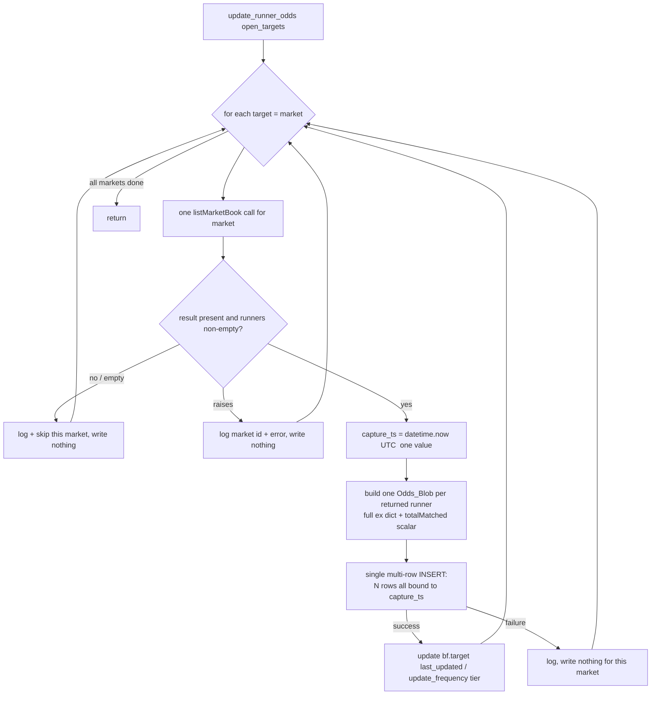

# Design Document

## Overview

This feature reworks the Betfair capture pipeline's odds Snapshot_Writer
(`MonitorService.update_runner_odds` in `monitor_service.py`) so that one poll
of a market records **all** of that market's runners as a single coherent
snapshot — every runner row sharing one Capture_Timestamp — and persists a
matched-volume figure inside each runner's Odds_Blob. It combines SP-396
(coherent per-poll snapshot) and SP-384 (matched-volume capture), which touch
the same seam and feed the same downstream consumer, the SP-368 research
dataset loader.

Two root causes are being fixed, both in `update_runner_odds`:

1. **Per-runner, per-instant capture (SP-396).** Today the method loops over a
   target's selection ids and issues one `listRunnerBook` call **per runner**,
   INSERTing each runner with its own SQL-literal `current_timestamp`. Because
   `current_timestamp` is evaluated per INSERT, the three MATCH_ODDS outcomes
   almost never share a timestamp, forcing every cross-outcome calculation to
   reconstruct a book by as-of forward-fill. That is benign pre-match but
   fabricates impossible sub-1.0 books in-play.

2. **No matched volume persisted (SP-384).** The writer stores only
   `result[0]["runners"][0]["ex"]` (the back/lay ladders). The SP-368
   `_matched_volume` reader looks for a scalar `totalMatched` or a
   `tradedVolume` ladder in the blob and finds neither, so every row's
   `matched_volume` is null.

The fix reuses the **already-defined** `listMarketBook` request template
(`api/request_body.py`), which returns every runner of a market in one call and
already requests `EX_BEST_OFFERS`, `EX_ALL_OFFERS`, and `EX_TRADED`. The writer
will: issue one `listMarketBook` call per market, compute one Python-side
Capture_Timestamp for that market's snapshot, store the full `ex` dict (which
carries `tradedVolume` from `EX_TRADED`) plus a `totalMatched` scalar lifted
from the runner-level `totalMatched`, and write all runner rows for the market
in a single atomic multi-row INSERT bound with that one shared timestamp.

**Hard constraints carried from requirements.**

- No backfill — this improves coverage going forward only (Req intro).
- The SP-368 loader / Odds_Transform format **must not change**
  (`logic/research_dataset.py`, `logic/quality_checks.py`,
  `scripts/build_research_dataset.py`). The writer must emit the shape the
  loader already reads (Req 2.8, 3.4).
- The change must be deployed and verified on the Pi via `scripts/deploy.sh`
  (Req 4).

### Verified vs assumed

Verified by reading the code in this repo:

- `api/request_body.py` — the `listMarketBook` template exists, takes a
  `"<ListOfMarketIDs>"` list placeholder, and requests
  `["EX_BEST_OFFERS", "EX_ALL_OFFERS", "EX_TRADED"]`.
- `monitor_service.py` — `process_targets` already calls `listMarketBook` with
  `{"<ListOfMarketIDs>": [market]}` and reads `result[0]["status"]` and
  `result[0]["runners"]` (a list of runner dicts each with `selectionId` and
  `ex`). This is the exact pattern the writer will reuse. The processed-target
  tuple shape is `(market, status, num_runners, runners, update_frequency,
  last_updated, event_start_time)`.
- `output/dboutput.py` — `DBOutputConnection.open_connection` sets
  `self.conn.autocommit = True`. `db_write(sql, params)` opens a cursor,
  `cursor.execute(sql, params)`, returns `True` on success and `False` on
  error (it swallows the exception and logs it). **Because the connection
  autocommits, each `db_write` call commits its own implicit transaction
  immediately** — this is the pivotal fact for the atomicity design below.
- `logic/quality_checks.py` — `parse_odds` runs `ast.literal_eval` on the
  stored string (a `str(dict)` repr, not JSON), requires both
  `availableToBack` and `availableToLay` as `{price, size}` lists, and
  preserves extra keys (explicitly `tradedVolume`) untouched. `serialize_odds`
  is `str(parsed)`.
- `logic/research_dataset.py` — `_matched_volume(parsed)` returns
  `float(totalMatched)` when `totalMatched` is a valid finite non-negative
  number (so **zero is honoured**, not treated as absent), else sums the
  `size` of each `{price, size}` entry in `tradedVolume` (each must be a dict
  with a valid numeric size), else `None`. `structured_odds` delegates the raw
  decode to `parse_odds`.

Assumed from the standard Betfair SportsAPING `listMarketBook` response shape
(not re-derived from a live response in this repo): `result` is a list of
MarketBook objects; `result[0]` carries `status`, a market-level
`totalMatched`, and `runners` (a list); each runner carries `selectionId`, a
runner-level `totalMatched` scalar, and `ex` with `availableToBack`,
`availableToLay`, and — because `EX_TRADED` is requested — `tradedVolume`. The
design treats the runner-level `totalMatched` as the natural source for the
blob's `totalMatched` key and reads `ex.tradedVolume` as already present in the
`ex` object. Where a particular key's presence is not guaranteed, the writer
guards with `.get(...)` and the matched-volume mapping table below defines the
behaviour for every presence combination.

## Architecture

The capture run loop (`MonitorService.run`) is unchanged. It still builds
`poll_targets` and calls `self.update_runner_odds(poll_targets)`. All change is
inside `update_runner_odds`, which moves from a **per-runner `listRunnerBook`**
model to a **per-market `listMarketBook` snapshot** model.

### Per-market snapshot flow



Key architectural shifts from today's implementation:

1. **One call per market, not per runner.** `listMarketBook` with
   `{"<ListOfMarketIDs>": [market]}` returns `result[0]["runners"]` — every
   runner in one response. The inner `for individual_runner in target[3]` loop
   and all `listRunnerBook` calls are removed.

2. **One timestamp computed in Python, bound as a parameter.** The current code
   relies on the SQL literal `current_timestamp`, which Postgres evaluates
   **per INSERT**, so it cannot produce one shared value across runner rows.
   The redesign computes `capture_ts = datetime.now(UTC)` once per market and
   binds it as a bind parameter in the INSERT, replacing the `current_timestamp`
   literal. This is the mechanism that satisfies Req 1.2 and Req 1.4 (see the
   Writer Redesign and Shared-Timestamp sections).

3. **Per-market failure isolation.** Each market's call + blob build + write is
   wrapped so an empty result, a missing response, or an exception affects only
   that market and the loop continues to the next. This is a deliberate
   behaviour change from the current whole-method `try/except` that re-raises
   `MonitorServiceException` and aborts the entire run. The outer safety net is
   retained as a backstop (see Error Handling).

4. **Atomic per-market write.** Because the DB connection autocommits per
   statement, N separate INSERTs would commit independently and a mid-snapshot
   crash could leave a partial coherent set. The redesign writes all N runner
   rows for a market in a **single parameterized multi-VALUES INSERT**, which is
   one statement and therefore one atomic autocommitted unit: either all N rows
   land or none do (Req 1.7).

The trailing `bf.target` `last_updated` / `update_frequency` tier logic (the
`tiers = DefaultStrategy.UPDATE_FREQUENCY_TIERS` block and the
`UPDATE bf.target SET last_updated=NOW(), update_frequency=%s ...` write) is
**preserved unchanged** and runs per market after a successful snapshot write.

## Components and Interfaces

| Component | File | Change |
|---|---|---|
| `MonitorService.update_runner_odds` | `monitor_service.py` | Rewritten: per-market `listMarketBook`, shared Python timestamp, single multi-row INSERT, per-market error isolation. Preserves the tier update tail. |
| `listMarketBook` template | `api/request_body.py` | **No change** — already defined and already requests `EX_TRADED`. |
| `DBOutputConnection.db_write` | `output/dboutput.py` | **No change** — reused as-is with a multi-row INSERT and a longer params tuple. |
| `logic/quality_checks.py` | — | **No change** (blob contract). |
| `logic/research_dataset.py` | — | **No change** (loader / Odds_Transform). |
| `scripts/build_research_dataset.py` | — | **No change** (dataset loader). |

The only production code file that changes is `monitor_service.py`. (The
requirements mention `simpleStategy.py` capture configuration; the
`listMarketBook` template already requests `EX_TRADED`, so no strategy/config
change is required to obtain matched volume — this is called out explicitly so
the task breakdown does not assume a config edit that is not needed.)

## Writer Redesign (`update_runner_odds`)

### Current behaviour (for reference)

For each target the current method loops `for individual_runner in target[3]`
and, per runner, issues a `listRunnerBook` call, reads
`odds = result[0]["runners"][0]["ex"]`, and executes:

```sql
INSERT INTO bf.market_table("timestamp", market_id, runner_id, odds)
VALUES (current_timestamp, %s, %s, %s);
```

with params `(target[0], individual_runner, odds_str)`. The per-runner
`current_timestamp` literal is the SP-396 root cause. Only `ex` is stored, so
no matched volume is persisted (SP-384 root cause). An existing
`if not result: ... continue` per-runner skip (SP-403) is present. The whole
method is wrapped in a `try/except` that logs to `bf.log_file` and re-raises
`MonitorServiceException`.

### New behaviour (per market)

For each `target` in `open_targets` (one target == one market):

1. **One Market_Book_Call.** Issue a single `listMarketBook` call for
   `target[0]` using the existing template and call pattern from
   `process_targets`:

   ```python
   resp = self.BF.call_obj.call(
       http_method=Methods.POST,
       url=Urls.JSON_RPC_BET,
       request_body=self.BF.request_body_obj.populate_template(
           "listMarketBook", {"<ListOfMarketIDs>": [target[0]]}
       ),
   )
   result = resp.json().get("result")
   ```

   Satisfies Req 1.1 (all runners from one call).

2. **Empty / missing guard (Req 1.5).** If `result` is falsy, or
   `result[0].get("runners")` is empty/absent, log a warning identifying the
   market, write no row for it, and `continue` to the next market. (Unlike
   `process_targets`, the writer does **not** mark the target EXPIRED — it only
   skips the poll; status transitions remain `process_targets`' responsibility.)

3. **One shared Capture_Timestamp (Req 1.2, 1.4).** Compute once, before
   building any row:

   ```python
   capture_ts = datetime.now(UTC)
   ```

   `datetime` and `UTC` are already imported at the top of
   `monitor_service.py`. This single value is bound to every runner row of the
   snapshot. Using `datetime.now(UTC)` keeps the code platform-independent
   (the capture runs in a Linux/ARM Docker container on the Pi while dev/tests
   run on Windows) and avoids any dependence on the DB server clock or on the
   per-statement evaluation of `current_timestamp`.

4. **Build one Odds_Blob per returned runner.** For each `runner` in
   `result[0]["runners"]`:
   - `selection_id = runner["selectionId"]`
   - `ex = runner.get("ex") or {}` — start from the full `ex` dict (it already
     carries `availableToBack`, `availableToLay`, and `tradedVolume` from
     `EX_TRADED`).
   - Apply the matched-volume mapping (next section) to produce the final blob
     dict, then render with `str(blob)` to match the stored `str(dict)` contract
     that `parse_odds` reads.

   Storing the **whole `ex` dict** (rather than a hand-built subset) is the
   safest change: `tradedVolume` flows through automatically, and both ladders
   remain present so `parse_odds` still accepts the blob.

5. **Single atomic multi-row INSERT (Req 1.3, 1.7).** Accumulate `(capture_ts,
   market_id, runner_id, odds_str)` for every runner and write them in one
   statement:

   ```sql
   INSERT INTO bf.market_table("timestamp", market_id, runner_id, odds)
   VALUES (%s, %s, %s, %s), (%s, %s, %s, %s), ... ;
   ```

   The `VALUES (...)` groups are generated to match the runner count N, and the
   params tuple is the flattened sequence of all N rows. Every row binds the
   **same** `capture_ts` object, guaranteeing one identical timestamp across the
   snapshot. Exactly one row per returned runner is produced — no runner
   omitted, no duplicate (Req 1.3). Betfair returns each selection once per
   market book, so N distinct `selectionId`s map to N rows.

6. **Preserve the tier update tail.** After a successful snapshot write, run the
   existing `DefaultStrategy.UPDATE_FREQUENCY_TIERS` selection against
   `target[6]` (event start time) and `datetime.now(UTC)`, and execute the
   unchanged:

   ```sql
   UPDATE bf.target SET last_updated=NOW(), update_frequency=%s WHERE market_id=%s;
   ```

   Existing target indexing is preserved: `target[0]` = market id, `target[6]`
   = event start time. `target[2]` remains used only in debug logging, as today.

### Notes on edge counts

- **N == 1** is valid: a one-runner market produces a single-row INSERT whose
  one row carries `capture_ts`. The shared-timestamp invariant holds trivially.
- A runner with no `ex` key yields an empty-ladder blob; see Req 2.6 handling
  below. Such a runner is still written (the loader will surface null prices),
  because Req 1.3 requires one row per returned runner.

## Matched-Volume Mapping (SP-384)

### The Odds_Blob contract and why it stays parseable

The stored Odds_Blob is a `str(dict)` rendering of the runner's `ex` object.
`logic/quality_checks.parse_odds` reads it with `ast.literal_eval` (a Python
dict repr, **not** JSON), and requires the dict to contain both
`availableToBack` and `availableToLay` as `{price, size}` lists; it preserves
any extra keys untouched (explicitly `tradedVolume`). `structured_odds`
delegates to `parse_odds` and then reads matched volume via `_matched_volume`.

Because the writer stores the **whole `ex` dict**, both ladders are always
present and the blob remains parseable by the unchanged loader. The
matched-volume keys live **inside that same dict**, so they ride through
`parse_odds` as preserved extra keys. This is why no loader change is needed
(Req 2.7, 2.8, 3.4).

### `_matched_volume` read order (the precedence the writer must feed)

Verified in `logic/research_dataset.py`:

1. scalar `parsed.get("totalMatched")` — used when it is a valid finite
   non-negative number (**zero is honoured**, not treated as absent);
2. else sum the `size` of each entry in `parsed.get("tradedVolume")` (each must
   be a dict with a valid numeric size);
3. else `None`.

So the writer should **prefer** persisting the `totalMatched` scalar; a
`tradedVolume` ladder alone also satisfies the loader.

### Writer mapping (set `ex["totalMatched"]` from the runner-level scalar)

The writer starts from the full `ex` dict (which may already contain
`tradedVolume`) and conditionally sets a `totalMatched` scalar from the
**runner-level** `totalMatched` returned by `listMarketBook`:

- If the runner carries a scalar `totalMatched` (including `0`), set
  `ex["totalMatched"] = <that scalar>`.
- Otherwise leave `totalMatched` unset.
- `tradedVolume` is whatever `ex` already carried (present from `EX_TRADED`, or
  absent); the writer does not fabricate it.
- If neither a scalar `totalMatched` nor a `tradedVolume` ladder is present,
  **omit both keys** (store `ex` with only the ladders). The writer must not
  write an empty `tradedVolume` list or a null `totalMatched` where the source
  has nothing, so that `_matched_volume` correctly yields `None` (Req 2.6).

### Case table

Let "scalar" = runner-level `totalMatched` present (a valid number, possibly
zero); "ladder" = `ex.tradedVolume` present and non-empty.

| # | Scalar | Ladder | Writer stores in blob | `_matched_volume` result | Req |
|---|---|---|---|---|---|
| 1 | yes (>0) | no | `totalMatched = s` | `s` | 2.1, 2.2 |
| 2 | yes (>0) | yes | `totalMatched = s` **and** `tradedVolume` (kept from `ex`) | `s` (scalar wins) | 2.3 |
| 3 | no | yes | `tradedVolume` (kept from `ex`); no `totalMatched` | sum of ladder sizes | 2.4 |
| 4 | yes (== 0) | no | `totalMatched = 0` | `0.0` (zero honoured, not omitted) | 2.5 |
| 5 | yes (== 0) | yes | `totalMatched = 0` **and** `tradedVolume` | `0.0` (scalar wins over ladder) | 2.5, 2.3 |
| 6 | no | no | neither key — ladders only | `None` | 2.6 |

Notes:

- Case 2/5: the scalar is authoritative for `_matched_volume`; keeping the
  ladder as well is harmless (it is only read when the scalar is absent) and
  avoids discarding data the loader may use elsewhere. Req 2.3 explicitly says
  the writer is **not required** to also persist the ladder, so keeping it is
  permitted, not mandated — keeping the full `ex` is simplest.
- Case 4: zero must be written, not omitted. Because the writer only sets
  `totalMatched` when the source value *is present* (an explicit
  `"totalMatched" in runner` / `is not None` guard), a genuine zero is set and
  a missing figure is left unset — the two are distinguished at the source.
- Case 6: both keys omitted, so the stored blob is exactly the back/lay ladders
  and `_matched_volume` returns `None`, surfacing as a null `matched_volume`
  column (Req 2.6, 3.3).

### Why the rendered blob round-trips unchanged

For any `ex` dict carrying the two ladders plus an optional `totalMatched`
and/or `tradedVolume`, `ast.literal_eval(str(ex))` reconstructs an equal dict
(all values are JSON-like scalars/lists of scalars), so:

- `parse_odds` accepts it (both ladders present) and preserves the extra
  matched-volume keys;
- `structured_odds` yields best_back = max of the back ladder, best_lay = min of
  the lay ladder, and `matched_volume` following the precedence above;
- the SP-368 `serialize_structured` round-trip (`str(parse_odds(raw))`) returns
  an equal value.

This is asserted directly by the round-trip correctness property below.

## Atomicity & Error Isolation

### Atomicity (Req 1.7) — verified basis

**Verified:** `DBOutputConnection.open_connection` sets
`self.conn.autocommit = True`. `db_write` executes a single
`cursor.execute(sql_command, params)` and returns `True`/`False`. With
autocommit on, **each `db_write` call commits its own implicit transaction the
moment the statement returns.** There is no multi-statement transaction wrapper
on this connection.

**Consequence:** the current per-runner loop issues N separate autocommitted
INSERTs. If the process crashes (or a later runner's INSERT fails) partway
through, the already-committed rows remain — a partial coherent set. That
violates the Req 1.7 all-or-nothing requirement once rows are meant to share a
timestamp.

**Design decision — single multi-VALUES INSERT per market.** All N runner rows
for a market are written in **one** parameterized statement:

```sql
INSERT INTO bf.market_table("timestamp", market_id, runner_id, odds)
VALUES (%s,%s,%s,%s), (%s,%s,%s,%s), ...;   -- N value groups
```

A single INSERT is one statement and therefore one atomic autocommitted unit:
Postgres applies all N rows or, on any error, none. This gives the Req 1.7
guarantee (all N rows at one shared timestamp, or zero rows for that poll)
**without modifying `output/dboutput.py`** — `db_write(sql, params)` already
accepts an arbitrary SQL string and a flat params tuple, so the writer just
builds the N value-group placeholder string and the flattened params.

This is the simplest atomic unit that fits the existing write path. An
alternative — wrapping N INSERTs in an explicit `BEGIN/COMMIT` — would require
either turning autocommit off (a cross-cutting change to a connection shared
with the advisory-lock logic, which the `try_acquire_run_lock` docstring warns
must stay session-scoped under autocommit) or adding a new transactional method
to `DBOutputConnection`. The single multi-row INSERT avoids touching that
connection's autocommit contract entirely and is preferred.

**Assumed (not load-tested here):** that Betfair returns a bounded number of
runners per market (MATCH_ODDS = 3; other markets small), so a single multi-row
INSERT stays well within statement/parameter limits. For football MATCH_ODDS
this is N = 3. No batching is needed at these sizes; if a future market type
returned very large N, the INSERT could be chunked, but that is out of scope.

### Error isolation (Req 1.5, 1.6) — behaviour change called out

Today `update_runner_odds` wraps the whole method in a `try/except` that logs
to `bf.log_file` and **re-raises `MonitorServiceException`**, so any single
market's failure aborts the entire run.

The redesign **isolates failures per market**: each market's call + build +
write runs inside a per-market `try/except`. On an exception (Req 1.6) it logs
an entry that identifies the failing market and the error, writes no row for
that market, and continues to the next market. On an empty/missing result
(Req 1.5) it logs and skips with no write. The per-market `UPDATE bf.target ...`
tail runs only after that market's snapshot write succeeds.

The outer method-level `try/except` is **retained as a backstop** so an
unexpected failure outside the per-market scope (e.g. an error iterating
`open_targets` itself) still records to `bf.log_file` and surfaces as
`MonitorServiceException`, preserving the existing durable-logging behaviour.
This is a deliberate, documented behaviour change: previously one bad market
ended the run; now one bad market is skipped and the rest are polled, which is
what Req 1.5/1.6 require ("continue polling the remaining markets").

Note the per-market write uses `db_write`, which returns `False` (rather than
raising) on a DB error. The writer treats a `False` return as a failed
snapshot for that market: it logs identifying the market and does **not** run
the tier `UPDATE` for it, then continues — so a failed write leaves zero rows
(the single INSERT is atomic) and does not advance `last_updated`.

## Data Models

No schema change. Rows are written to the existing `bf.market_table`:

| Column | Source |
|---|---|
| `timestamp` | one shared `capture_ts = datetime.now(UTC)` per market snapshot |
| `market_id` | `target[0]` |
| `runner_id` | `runner["selectionId"]` from the market book |
| `odds` | `str(ex_with_optional_totalMatched)` — the Odds_Blob |

The Odds_Blob dict shape (a `str(dict)` of):

```python
{
    "availableToBack": [{"price": float, "size": float}, ...],
    "availableToLay":  [{"price": float, "size": float}, ...],
    # optional, per the matched-volume case table:
    "tradedVolume":    [{"price": float, "size": float}, ...],  # from EX_TRADED
    "totalMatched":    float,                                   # runner-level scalar
}
```

This is exactly the shape `logic/quality_checks.parse_odds` /
`logic/research_dataset.structured_odds` already parse. No new model types are
introduced.

## Correctness Properties

*A property is a characteristic or behavior that should hold true across all
valid executions of a system — essentially, a formal statement about what the
system should do. Properties serve as the bridge between human-readable
specifications and machine-verifiable correctness guarantees.*

This feature **is** a good fit for property-based testing: the blob-building
and row-assembly logic is pure (given a synthesized `listMarketBook` result it
produces rows and blob strings with no I/O), has clear input/output behaviour,
and has universal round-trip and invariant properties over a large input space
(arbitrary ladders, matched-volume figures, and runner counts). The repo
already property-tests exactly this blob shape with `hypothesis`
(`tests/test_property_research_dataset.py`,
`tests/test_property_quality_checks.py`), whose `valid_odds_values` composite
and ladder generators are reused here as the single source of valid-blob
shapes.

The pure logic under test is factored out of `update_runner_odds` into small
pure helpers (e.g. a function that builds the Odds_Blob dict for one runner from
its `ex` + runner-level `totalMatched`, and a function that assembles the N
`(capture_ts, market_id, runner_id, odds_str)` rows for a market from a parsed
`listMarketBook` result and a timestamp). Property tests target those helpers;
the thin API/DB wiring is covered by the example/integration tests in the
Testing Strategy.

**Property reflection applied.** The prework flagged these consolidations:
acceptance criteria 1.2, 1.3, and 1.4 all describe the same per-market row-set
shape (N rows, one per runner, all sharing one identical timestamp) and are
merged into the coherent-snapshot property (Property 2). Acceptance criteria
2.1–2.6 and 3.2/3.3 all describe the same matched-volume mapping read back
through the loader and are merged into the round-trip property (Property 1) —
the zero scalar of 2.5 is covered as an input the generator must include, and
the no-volume branch of 2.6/3.3 is covered by that property's absent case.
Criteria 2.7/2.8/3.4 (same-blob, parseable, no-loader-change) are covered by the
round-trip property's "best_back/best_lay survive alongside matched_volume from
the same blob" assertion and by the loader-acceptance property (Property 4).

### Property 1: Matched-volume round-trip through the unchanged loader

*For any* synthesized `ex` dict (valid non-negative finite back/lay ladders)
combined with an optional runner-level `totalMatched` scalar (including zero)
and/or an optional `tradedVolume` ladder, the blob string the writer renders
for that runner, when read back through the unchanged
`logic.research_dataset.structured_odds`, yields a `StructuredOdds` whose
`matched_volume` equals the expected figure — the scalar when a scalar is
present (zero honoured), else the summed `tradedVolume` sizes when only a ladder
is present, else `None` — and whose `best_back` (max back price) and `best_lay`
(min lay price) equal those of the source ladders.

**Validates: Requirements 2.1, 2.2, 2.3, 2.4, 2.5, 2.6, 2.7, 2.8, 3.2, 3.3**

### Property 2: Coherent snapshot — N rows, one per runner, one shared timestamp

*For any* market whose `listMarketBook` result returns N ≥ 1 runners (with
arbitrary distinct `selectionId`s and arbitrary `ex` content) and any single
`capture_ts`, the writer's row-assembly produces exactly N rows whose
`runner_id` values are exactly the N returned `selectionId`s (one per runner, no
omission, no duplicate) and whose `timestamp` values are all equal to that one
identical `capture_ts`.

**Validates: Requirements 1.2, 1.3, 1.4**

### Property 3: Per-market write atomicity

*For any* market with N ≥ 1 runners, a write that fails yields zero persisted
rows for that market's poll, and a write that succeeds yields exactly N rows all
sharing the one `capture_ts` — never an incomplete subset. The writer emits a
single multi-row `INSERT` statement for the market so that the N rows are one
atomic unit (all-or-nothing) under the autocommitting connection.

**Validates: Requirements 1.7**

### Property 4: Emitted blobs are accepted by the unchanged loader

*For any* blob the writer renders (any valid ladders with any of the
matched-volume key combinations from the mapping table), the unchanged
`logic.research_dataset.structured_odds` parses it to a non-`None`
`StructuredOdds`, and the SP-368 serialize round-trip
(`serialize_structured`) reproduces an equal value — demonstrating the writer
emits exactly the string shape the loader already reads, with no change to
`logic/research_dataset.py`, `logic/quality_checks.py`, or
`scripts/build_research_dataset.py`.

**Validates: Requirements 2.8, 3.4**

## Error Handling

| Scenario | Requirement | Handling |
|---|---|---|
| `listMarketBook` returns falsy `result`, or `result[0]["runners"]` empty/absent | 1.5 | Log a warning identifying the market; write no row; `continue` to the next market. Do not mark EXPIRED (status transitions stay in `process_targets`). |
| `listMarketBook` call or JSON parse raises for a market | 1.6 | Per-market `try/except`: log an entry identifying the market and the error; write no row for it; `continue` to the next market. |
| `db_write` returns `False` (DB error on the multi-row INSERT) | 1.6, 1.7 | Treat as a failed snapshot: log identifying the market; skip the tier `UPDATE` for it; `continue`. The single INSERT is atomic, so zero rows persisted. |
| Unexpected failure outside the per-market scope | — | Outer method-level `try/except` (retained): log to `bf.log_file` and raise `MonitorServiceException`, preserving existing durable-logging behaviour. |
| Runner has no/empty `ex` | 1.3, 2.6 | Still written (one row per returned runner) with empty ladders and no matched-volume keys; loader surfaces null prices and null matched_volume. |

Behaviour-change note (restated for implementers): the current whole-method
`try/except` aborts the run on any market's failure. The redesign isolates
failures per market so the run continues, per Req 1.5/1.6, while keeping the
outer net as a backstop.

## Testing Strategy

Tests run through the project venv per the testing/environment steering:
`d:\projects\bf_trader_py\.venv\Scripts\python.exe`. Shell is PowerShell —
chain with `;`, not `&&`. Ruff line length is 120. **Do not run tests
mid-task**; the single end-of-task verification gate runs ruff then the full
`pytest` once, before any push/PR/marking Done. (The design phase makes no code
changes, so no run is performed now.)

Code must stay platform-independent: the capture runs in a Linux/ARM Docker
container on the Pi while dev/tests run on Windows. Use `datetime.now(UTC)` and
avoid OS-specific calls — the writer uses only `datetime`/`timedelta` and the
existing DB/API layers, so this holds.

### Property-based tests (hypothesis)

One property-based test per correctness property, each ≥ 100 iterations
(`@settings(max_examples=...)`), each tagged with a comment referencing the
design property in the form
`# Feature: coherent-market-snapshot-capture, Property N: <text>`. Generators
reuse the existing `valid_odds_values` / ladder composites from
`tests/test_property_research_dataset.py` (extended with optional
`totalMatched` scalars including zero and optional `tradedVolume` ladders) so
there is one source of truth for valid blob shapes.

- **Property 1** — generate `ex` + optional scalar/ladder; build the blob via
  the writer helper; assert `structured_odds(blob).matched_volume` equals the
  expected figure (scalar preferred incl. zero, else summed ladder, else
  `None`) and `best_back`/`best_lay` match the source ladders.
- **Property 2** — generate N ≥ 1 runners with distinct `selectionId`s; assemble
  rows for one `capture_ts`; assert the row `runner_id` multiset equals the
  `selectionId` set and every row's timestamp is that one value.
- **Property 3** — generate N runners; with an injected failing write assert
  zero persisted rows; with a succeeding write assert exactly N; assert the
  writer issues a single INSERT statement for the market.
- **Property 4** — for any emitted blob, assert `structured_odds` is non-`None`
  and `serialize_structured(structured_odds(blob))` round-trips to an equal
  value.

### Unit / example tests

- **1.5 empty/missing result** — `result` is `None`; `result` is `[]`;
  `result[0]["runners"]` empty/absent → zero rows, loop continues.
- **1.6 call raises** — inject an exception for one market → logged with the
  market id, zero rows for it, next market still polled.
- **1.1 wiring** (INTEGRATION, mock-based) — assert the writer issues exactly
  one `listMarketBook` populate_template per market and **no** `listRunnerBook`
  call; assert the tier `UPDATE bf.target` still runs after a successful write.
- **3.1 / 3.5 loader coherence** (example) — feed `build_records` three rows at
  one timestamp (HOME/DRAW/AWAY) → exactly one observation per role at that
  exact timestamp, none carried forward.

### No-loader-change guard

The test suite imports and exercises the **unchanged**
`logic.research_dataset.structured_odds` / `build_records` and
`logic.quality_checks.parse_odds` against writer-emitted blobs. These files and
`scripts/build_research_dataset.py` are not modified by this feature (Req 3.4);
Property 4 fails if an emitted blob ever stops parsing under the unchanged
loader.

## Pi Deployment & Verification (Req 4)

Deployment targets the Raspberry Pi that runs the Betfair capture stack. Reach
the Pi over SSH per the `pi-access` steering (no credentials are reproduced
here). Deployment uses the project's own script — **do not** hand-run docker
commands when the script exists.

1. **Deploy (Req 4.1, 4.2).** On the Pi, run `scripts/deploy.sh`, which syncs
   code, validates `.env`, and rebuilds/recreates the capture container
   (`docker compose up -d --build`) with post-deploy verification. Confirm the
   recreated container is running. If a step fails, `deploy.sh` reports the
   failed step and leaves the previously running container unchanged (Req 4.2).

2. **Let a capture cycle run (Req 4.3, 4.4).** Within ~10 minutes after deploy,
   a capture cycle on a currently-captured market should write a Market_Snapshot
   whose runner rows share one identical `timestamp`, and at least one row whose
   blob carries a matched-volume figure. Spot-check with a DB query on
   `bf.market_table` (group a market's recent rows by `timestamp`; confirm a
   timestamp with all its runners, and a blob containing `totalMatched` or
   `tradedVolume`).

3. **Build the research dataset (Req 4.5, 4.6).** Run
   `scripts/build_research_dataset.py` (unchanged) against a Pi-captured market
   and confirm (a) at least one instant where all three MATCH_ODDS outcomes
   (HOME, DRAW, AWAY) are present at one shared `timestamp`, and (b) a non-null
   `matched_volume` for at least one runner observation.

4. **No regression on historical rows (Req 4.7).** The writer is INSERT-only; it
   never updates or deletes existing `bf.market_table` rows, so every row
   captured before the deploy keeps its stored Odds_Blob and timestamp. Verify
   by spot-checking a sample of pre-deploy rows before/after. Backfill is out of
   scope — the improvement is forward-only.

Per the deployable-work definition of done, the ticket stays in **Mostly Done**
until the deploy is done and verified on the Pi; the completion comment should
note the deploy and the verification evidence (a coherent all-outcomes instant
and a non-null matched_volume).
