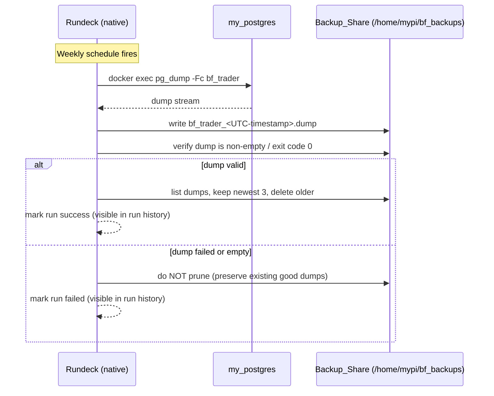
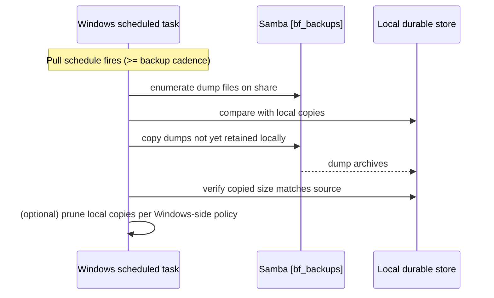
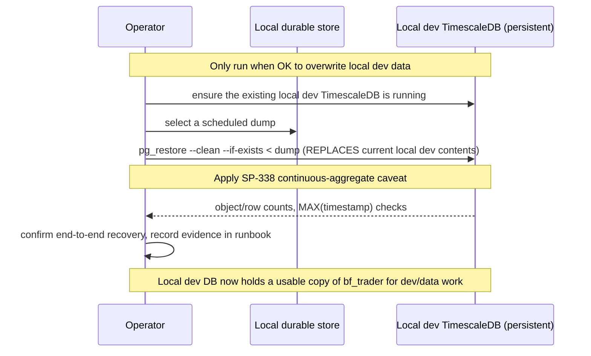

# Design Document: Pi Postgres Backup Automation

> Tracked by **SP-363** — _Automate Postgres backups on the Pi (scheduled pg_dump + off-Pi retention)_.
> Builds on **SP-338** (storage relocation + Backup_Share) and **SP-328** (capture infra / Rundeck schedule).

## Overview

The Betfair capture stack runs Postgres/TimescaleDB (container `my_postgres`, database `bf_trader`) on an always-on Raspberry Pi under Docker. SP-338 created a dedicated off-USB Backup_Share (`/home/mypi/bf_backups`, Samba `[bf_backups]`, deliberately on the SD-card root so a USB failure cannot destroy backups) and documented a logical `pg_dump`/`pg_restore` path in the storage runbook. Today backups are manual-only: a single safety dump exists from SP-338, and any Pi/SD/USB failure loses everything captured since the last hand-run dump.

This design automates recurring backups and durable off-Pi retention. A **Rundeck job running natively on the Pi** executes `pg_dump -Fc` of `bf_trader` on a **weekly** cadence, writing compressed custom-format dumps into the existing Backup_Share. A **Pi-side retention step** prunes old dumps so the share does not grow unbounded. Separately, the **Windows PC pulls** the dumps off the Pi over the existing Samba share (the Pi never pushes), giving a durable copy that survives total loss of the Pi. Finally, a one-time **restore rehearsal** into the operator's existing persistent local dev TimescaleDB (a real Docker container on the dev machine, set up identically to the Pi's `my_postgres` — same image/config) both confirms the dumps are recoverable end-to-end **and** leaves a usable copy of the `bf_trader` data on the dev machine for local development and data-analysis work. Because the restore replaces the local dev DB's current contents, the rehearsal is run only when the operator is happy to overwrite whatever is in the local dev DB.

The design is intentionally high-level: it defines the components, their contracts, the data model for dump artifacts, and the operational flows. It reuses existing infrastructure (the Backup_Share, native Rundeck, `my_postgres`) and adds only a scheduled job, a retention mechanism, a Windows pull mechanism, and runbook documentation. This feature's canonical operational documentation — schedule, dump location, retention, the Windows pull, and the restore/continuous-aggregate caveat — lives in a new in-repo markdown runbook at `docs/SP-363_postgres_backup_runbook.md`. SP-338 remains the origin of the Backup_Share and the original continuous-aggregate caveat knowledge, but the actionable doc this feature produces is the repo runbook, not Confluence.

## Design Decisions

- **Retention policy: keep the last 3 dumps (count-based).** Count-based pruning is simpler and more predictable than age-based for a weekly cadence: "keep last 3" always retains ~3 weeks of history with a bounded, deterministic footprint regardless of how reliably the job fires, and it is trivial to reason about ("delete all but the newest 3"). A 30-day age rule was offered as an acceptable alternative; it is rejected as the primary policy only because a stalled scheduler could age out every dump and leave the share empty, whereas count-based retention always preserves the most recent successful dumps. The 3 most recent dumps are retained on the Pi; the Windows pull keeps its own, independently-retained copies off-Pi.
- **Rundeck native job, not cron.** Rundeck already runs natively on the Pi (not in a container), already writes to the share location, and provides run history, logging, and failure visibility consistent with the rest of the capture infrastructure (SP-328). Cron is noted only as a fallback for environments without Rundeck; it is not the chosen path.
- **Windows pulls, Pi does not push.** The Pi exposes the Backup_Share over Samba (SP-338). The off-Pi durability step is a scheduled task on the Windows PC that mounts/reads the share and copies new dumps locally. Keeping the Pi as a passive source avoids storing Windows credentials on the Pi and keeps the trust boundary one-directional.
- **Custom format (`-Fc`).** `pg_dump -Fc` produces a single compressed archive that `pg_restore` can replay selectively, matching the restore path already documented in the SP-338 runbook.
- **TimescaleDB continuous-aggregate caveat.** The continuous-aggregate-on-restore caveat was first recorded under SP-338. This feature carries that caveat forward into its own canonical runbook at `docs/SP-363_postgres_backup_runbook.md`, where the restore-into-local-dev-TimescaleDB handling is documented. The design references the caveat rather than redefining it; the restore rehearsal is the control that proves the documented path works.

## Architecture

```mermaid
graph TD
    subgraph PI["Raspberry Pi (always-on, Docker host)"]
        RD["Rundeck (native)<br/>weekly Backup Job"]
        PG["my_postgres container<br/>bf_trader (Postgres/TimescaleDB)"]
        BK["/home/mypi/bf_backups<br/>Backup_Share (SD-card root, OFF the USB)"]
        RET["Retention step<br/>keep last 3 dumps"]
        SMB["Samba [bf_backups] share"]

        RD -->|docker exec pg_dump -Fc| PG
        PG -->|dump archive| BK
        RD --> RET
        RET -->|prune oldest| BK
        BK --- SMB
    end

    subgraph WIN["Windows PC (operator)"]
        PULL["Scheduled pull task<br/>(Task Scheduler)"]
        STORE["Local durable store<br/>(off-Pi retained copies)"]
        DEV["Existing local dev TimescaleDB<br/>(persistent Docker container,<br/>identical setup to Pi's my_postgres)"]
    end

    SMB -->|read / copy new dumps| PULL
    PULL --> STORE
    STORE -.->|restore rehearsal<br/>pg_restore (replaces local dev data)| DEV

    classDef pi fill:#eef,stroke:#669;
    classDef win fill:#efe,stroke:#696;
    class RD,PG,BK,RET,SMB pi;
    class PULL,STORE,DEV win;
```

The weekly flow is fully contained on the Pi (dump → write → prune). The durability and rehearsal flows live on the Windows side and read from the Pi over Samba. No component on the Pi initiates a connection to Windows.

## Sequence Diagrams

### Weekly backup + retention (on the Pi, via Rundeck)



### Off-Pi retention pull (on Windows)



### Restore rehearsal (into the existing local dev TimescaleDB)



## Components and Interfaces

### Component 1: Rundeck Backup Job (native, on the Pi)

**Purpose**: Produce a weekly compressed dump of `bf_trader` into the Backup_Share and trigger retention. This is the scheduled replacement for the manual `pg_dump` from SP-338.

**Interface (job contract)**:
- **Trigger**: weekly schedule (fixed day/time, Pi local time).
- **Action**: run `pg_dump -Fc` of `bf_trader` via `docker exec my_postgres`, redirecting output to a new timestamped file under `/home/mypi/bf_backups`.
- **Inputs**: database name `bf_trader`, container `my_postgres`, target directory `/home/mypi/bf_backups`.
- **Outputs**: one dump artifact (see Data Models) and a Rundeck run record (success/failure, log, duration).
- **Failure contract**: a non-zero dump exit code or an empty/zero-byte output file marks the run **failed** and MUST NOT trigger pruning, so a bad run cannot cascade into deleting good dumps.

**Responsibilities**:
- Invoke the dump against the running `my_postgres` container.
- Name the artifact deterministically with a UTC timestamp.
- Validate the artifact before declaring success.
- Invoke the Retention step only on success.
- Surface failures through Rundeck run history (consistent with SP-328 visibility).

### Component 2: Retention Step (on the Pi)

**Purpose**: Bound the Backup_Share footprint by keeping only the newest 3 dumps.

**Interface**:
- **Input**: the set of dump files in `/home/mypi/bf_backups` matching the dump naming pattern.
- **Policy**: retain the 3 most recent (by embedded timestamp / mtime); delete the rest.
- **Output**: a Backup_Share containing at most 3 dumps after a successful run.
- **Invocation**: called by the Backup Job after a validated dump; never runs on a failed dump.

**Responsibilities**:
- Select only files matching the backup naming pattern (never touch unrelated files on the share).
- Preserve the newest 3; delete older ones.
- Be idempotent and safe to re-run.

### Component 3: Backup_Share (existing, SP-338)

**Purpose**: Durable-on-the-Pi, off-USB landing zone for dumps, exposed over Samba for the Windows pull.

**Interface**:
- **Host path**: `/home/mypi/bf_backups` (SD-card root, NOT on `/mnt/data`).
- **Samba share**: `[bf_backups]` — `read only = no`, `valid users = mypi`.
- **Consumers**: the Backup Job writes; the Retention step prunes; the Windows pull reads.

**Responsibilities**: unchanged from SP-338 — this design consumes the share, it does not redefine it.

### Component 4: Windows Pull Task (off-Pi retention)

**Purpose**: Copy dumps off the Pi to durable Windows storage so backups survive total loss of the Pi (SD + USB).

**Interface**:
- **Trigger**: Windows Task Scheduler, at a cadence at least as frequent as the weekly backup.
- **Source**: the `[bf_backups]` Samba share on the Pi (read access as `mypi`).
- **Action**: enumerate dumps on the share, copy any not already present locally, verify copied size.
- **Output**: local durable copies in an operator-chosen location.
- **Direction**: pull only — the Pi never initiates the transfer.

**Responsibilities**:
- Authenticate to the share and read dump files.
- Avoid re-copying already-retained dumps (idempotent).
- Verify each copy (size match) before considering it retained.
- Apply its own off-Pi retention (independent of the Pi's keep-last-3), so history can be kept longer off-Pi if desired.

### Component 5: Restore Rehearsal (into the existing local dev TimescaleDB)

**Purpose**: Prove a scheduled dump restores end-to-end into an equivalent TimescaleDB, confirming the documented restore path and the continuous-aggregate caveat — while also leaving a usable copy of the `bf_trader` data on the dev machine for local development and data-analysis work. The target is the operator's **existing persistent local dev TimescaleDB** (a real Docker container set up identically to the Pi's `my_postgres` — same image/config), not a disposable instance.

**Interface**:
- **Input**: one scheduled dump from the durable store.
- **Target**: the operator's existing persistent local dev TimescaleDB Docker container (identical setup to the Pi's `my_postgres`). The restore populates this real local dev DB for ongoing reuse.
- **Action**: `pg_restore --clean --if-exists` into the target, applying the SP-338 continuous-aggregate handling. `--clean --if-exists` **replaces** the local dev DB's current objects/data with the dump's contents, so this is run only when the operator is happy to overwrite whatever is currently in the local dev DB.
- **Output**: verification evidence (object counts, row counts, MAX timestamps) recorded in the runbook, plus a restored local dev dataset ready for dev/data use.

**Responsibilities**:
- Restore without touching the Pi's production `my_postgres`.
- Only run when overwriting the local dev DB contents is acceptable, since the restore replaces them.
- Validate the restored data matches expectations.
- Record the rehearsal result so the restore path is known-good.

## Data Models

### Model 1: Dump Artifact

A single compressed `pg_dump -Fc` output file produced by one backup run.

| Field | Description |
|---|---|
| Filename | `bf_trader_<UTC-timestamp>.dump` (e.g. `bf_trader_20260115T030000Z.dump`) |
| Location (on Pi) | `/home/mypi/bf_backups/` |
| Format | Postgres custom format (`-Fc`), compressed, restorable with `pg_restore` |
| Source database | `bf_trader` in container `my_postgres` |
| Created by | Rundeck Backup Job (weekly) |

**Validation Rules**:
- Filename MUST embed a sortable UTC timestamp so newest-N selection is unambiguous across the Pi and Windows copies.
- A valid artifact is non-empty (> 0 bytes) and produced by a zero-exit `pg_dump`.
- The naming pattern MUST be specific enough that the Retention step and the Windows pull can select dump files without matching unrelated files on the share.

### Model 2: Retention Set (on the Pi)

The collection of dump artifacts currently on the Backup_Share.

| Field | Description |
|---|---|
| Members | Dump artifacts matching the naming pattern in `/home/mypi/bf_backups` |
| Retention rule | Keep the 3 most recent by timestamp; delete older |
| Post-condition | After a successful run, at most 3 dumps remain |

**Validation Rules**:
- Ordering for "newest 3" MUST derive from the embedded UTC timestamp (preferred) or file mtime as a fallback.
- Pruning MUST only occur after a validated dump.
- The chosen policy is count-based (last 3). The 30-day age alternative is documented but not the implemented rule (see Design Decisions).

### Model 3: Off-Pi Retained Copy (on Windows)

A copy of a dump artifact pulled to durable Windows storage.

| Field | Description |
|---|---|
| Source | `[bf_backups]` Samba share on the Pi |
| Location | Operator-chosen durable path on the Windows PC |
| Retention rule | Independent of the Pi; may keep more history than keep-last-3 |
| Integrity check | Copied file size matches the source on the share |

**Validation Rules**:
- A dump is considered retained off-Pi only after a verified copy.
- The pull MUST be idempotent: already-retained dumps are not re-copied.

## Error Handling

### Scenario 1: Dump command fails or produces an empty file

**Condition**: `pg_dump` exits non-zero, or the output file is zero bytes (e.g. `my_postgres` down, disk full).
**Response**: the Rundeck run is marked **failed**; the Retention step is **not** invoked.
**Recovery**: existing valid dumps (on the Pi and on Windows) are untouched; the operator sees the failure in Rundeck run history and re-runs after fixing the cause. Failing closed protects good dumps from being pruned by a bad run.

### Scenario 2: Backup_Share unwritable or disk full

**Condition**: the SD-card root cannot accept a new dump.
**Response**: the dump write fails → run marked failed (same path as Scenario 1).
**Recovery**: keep-last-3 retention bounds normal growth; the operator investigates SD-card space. No pruning occurs on failure, so the newest good dumps remain.

### Scenario 3: Windows pull cannot reach the share

**Condition**: Pi offline, network down, or Samba unavailable when the Windows task runs.
**Response**: the pull task fails for that cycle without affecting the Pi-side dumps.
**Recovery**: the next successful pull catches up (idempotent copy of any dumps not yet retained locally). Because the Pi keeps the last 3, a missed weekly pull still has multiple dumps available to catch up from.

### Scenario 4: Restore rehearsal reveals continuous-aggregate issues

**Condition**: continuous aggregates do not restore cleanly into the local dev TimescaleDB (the known TimescaleDB caveat, first recorded under SP-338).
**Response**: follow the caveat handling documented in the repo runbook `docs/SP-363_postgres_backup_runbook.md` during the rehearsal.
**Recovery**: the rehearsal is the control that surfaces this before a real disaster; outcomes and any required steps are recorded in the runbook. Because the rehearsal targets the operator's real local dev DB (and `pg_restore --clean --if-exists` replaces its contents), the rehearsal is only started once the operator has accepted overwriting the current local dev data.

### Scenario 5: Scheduler (Rundeck) stalls and no dumps are produced

**Condition**: the weekly job stops firing.
**Response**: with count-based retention the 3 most recent dumps are preserved indefinitely (they are never aged out), so a stall does not silently empty the share — this is the specific failure mode that motivated choosing keep-last-3 over a 30-day age rule.
**Recovery**: missed/failed runs are detectable via Rundeck run history (consistent with SP-328 visibility).

## Correctness Properties

> Note (design-first): requirements have not yet been derived from this design. The
> `Validates:` references below are provisional numeric IDs derived from the SP-363
> acceptance criteria and will be reconciled with the formal requirement IDs when
> `requirements.md` is generated.

### Property 1: Weekly cadence
Over any sufficiently long window, the Backup Job fires on its weekly schedule, and each successful fire produces exactly one new dump artifact.

**Validates: Requirements 1.1** (scheduled Rundeck job runs `pg_dump -Fc` of `bf_trader` weekly)

### Property 2: Off-USB placement
Every dump is written under `/home/mypi/bf_backups` (SD-card root) and never onto `/mnt/data`, so a USB failure cannot destroy backups.

**Validates: Requirements 2.1** (dumps written to the off-USB Backup_Share)

### Property 3: Retention bound
After any successful run, the Backup_Share contains at most 3 dump artifacts, and those are the 3 most recent.

**Validates: Requirements 3.1** (retention policy prunes old dumps — keep last 3)

### Property 4: Fail-closed pruning
Pruning only ever runs after a validated, non-empty dump; a failed run never deletes an existing dump.

**Validates: Requirements 3.2** (retention policy prunes old dumps — keep last 3)

### Property 5: Off-Pi durability
For every dump that persists on the share long enough for one pull cycle, a verified copy exists on the Windows PC, and the Pi never initiates that transfer.

**Validates: Requirements 2.2** (Windows PC pulls dumps off the Pi for durable retention)

### Property 6: Pull idempotence
Running the Windows pull repeatedly does not create duplicate retained copies and does not re-copy already-retained dumps.

**Validates: Requirements 2.3** (Windows PC pulls dumps off the Pi for durable retention)

### Property 7: Restorability
A dump produced by the scheduled job restores into the operator's existing persistent local dev TimescaleDB (identical setup to the Pi's `my_postgres`) via the documented `pg_restore` path (proven once by the rehearsal), replacing the local dev DB's prior contents and leaving a usable `bf_trader` copy for local dev/data work.

**Validates: Requirements 5.1** (restore from a scheduled dump rehearsed into the local dev TimescaleDB once)

## Testing Strategy

### Verification approach

This feature is primarily operational (scheduled job + file retention + a Windows copy task), so verification is mostly behavioural and manual, anchored by the one-time restore rehearsal.

- **Backup Job**: trigger the Rundeck job on demand and confirm a new, non-empty, correctly named dump appears in `/home/mypi/bf_backups`; confirm the run shows success in Rundeck history.
- **Retention**: seed the share with 4+ dummy dump files, run the job (or the retention step), and confirm exactly the newest 3 remain and only pattern-matching files were touched.
- **Fail-closed**: simulate a failing dump (e.g. stop `my_postgres`) and confirm the run is marked failed and no existing dump is pruned.
- **Windows pull**: run the scheduled task against the share and confirm new dumps are copied, sizes match, and a second run copies nothing new (idempotence).

### Integration / end-to-end

- **Restore rehearsal (the key gate)**: restore a real scheduled dump into the operator's existing persistent local dev TimescaleDB Docker container (identical setup to the Pi's `my_postgres`) with `pg_restore --clean --if-exists`, apply the SP-338 continuous-aggregate caveat, and verify object/row counts and MAX timestamps. Note that `--clean --if-exists` replaces the local dev DB's current contents, so run it only when overwriting local dev data is acceptable. Record evidence in the runbook. This is the acceptance control proving the whole chain works, and it leaves a usable `bf_trader` copy on the dev machine for local dev/data-analysis work.

## Security Considerations

- **Credential direction**: the Windows PC pulls using its own Samba credentials (`mypi`); no Windows credentials are stored on the Pi. The trust boundary stays one-directional (Windows → Pi read).
- **Dump contents**: dumps contain the full `bf_trader` dataset. Durable Windows copies should live in an access-controlled location; the Backup_Share remains restricted to `valid users = mypi` as defined in SP-338.
- **No new network exposure**: the design reuses the existing Samba share and native Rundeck; it opens no new ports or services on the Pi.

## Dependencies

- **Existing Pi infrastructure (SP-338)**: Backup_Share `/home/mypi/bf_backups`, Samba `[bf_backups]`, container `my_postgres` running `bf_trader`.
- **Native Rundeck on the Pi (SP-328)**: provides the scheduler, run history, and failure visibility. **Cron is a documented fallback only.**
- **Postgres client tools** inside/available to `my_postgres`: `pg_dump` / `pg_restore` (custom format `-Fc`).
- **Windows PC**: Task Scheduler for the pull task; SMB client access to the Pi share; durable local storage.
- **Dev machine**: the operator's existing persistent local dev TimescaleDB Docker container, set up identically to the Pi's `my_postgres` (same image/config), which serves as the restore-rehearsal target and retains a usable `bf_trader` copy for local dev/data work after the rehearsal.
- **Repo runbook `docs/SP-363_postgres_backup_runbook.md`**: the canonical location to document schedule, dump location, retention policy, the Windows pull procedure, and the restore/continuous-aggregate caveat. This feature produces/updates this in-repo markdown doc (following the existing `docs/SP-NNN_short_name.md` pattern). SP-338 remains the infra/knowledge origin (Backup_Share and the original caveat), but the documentation output for this feature lives in the repo doc, not Confluence.

## Documentation Impact

Per the acceptance criteria, this feature's documentation home is a new in-repo markdown runbook at `docs/SP-363_postgres_backup_runbook.md` (the repo already has a `docs/` folder with files following the `docs/SP-NNN_short_name.md` pattern, e.g. `docs/SP-369_odds_behaviour_analysis.md`). That new doc — not Confluence — is where the following are documented: the weekly schedule, the dump location (`/home/mypi/bf_backups`), the keep-last-3 retention policy (noting the 30-day alternative was considered), the Windows pull procedure for off-Pi retention, the restore-into-local-dev-TimescaleDB procedure, the TimescaleDB continuous-aggregate caveat, and the recorded outcome of the restore rehearsal. The runbook should note that the rehearsal restores into the real local dev DB (identical setup to the Pi's `my_postgres`) and that `pg_restore --clean --if-exists` replaces its current contents, so it is run only when overwriting local dev data is acceptable — the upside being a usable `bf_trader` copy on the dev machine for local dev/data work. SP-338 may be cited in the runbook as the origin of the Backup_Share and the original continuous-aggregate caveat knowledge, but the canonical operational documentation this feature produces lives in the repo markdown doc.
