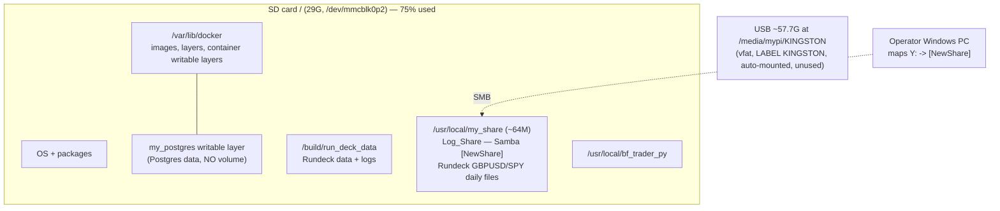
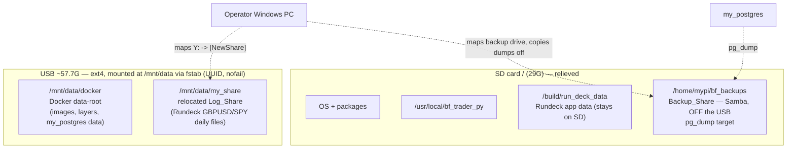

# Design Document: Pi Storage Expansion (SP-338)

## Overview

The always-on Raspberry Pi runs the Betfair capture stack on a single 29G SD-card
root filesystem (`/dev/mmcblk0p2`). The SP-336 outage was caused by that filesystem
filling to 100%, which crash-looped Postgres and stopped capture. The underlying
risk is that the OS, Docker images/layers, container and Rundeck logs, and the
Postgres data all compete for one small, write-limited card.

This design provisions the already-inserted 64GB USB drive (reporting ~57.7G usable,
currently auto-mounted at `/media/mypi/KINGSTON`) as persistent, reboot-safe,
Linux-native storage, then relocates the highest-growth and highest-write data onto
it. The guiding goals are to extend SD-card endurance, keep the root filesystem below
60% used, and perform the move without losing captured market data.

As of the latest read-only check the root filesystem (`/dev/mmcblk0p2`, PARTUUID
`07763972-02`, 29G) is **75% used (21G used, 7.0G available)** — the SP-336 cleanup
had brought it to roughly 72%, but it has since crept back up, which is why
relocating the recurring write sources (the Docker data root and the Rundeck-written
Log_Share) is now in scope rather than optional.

### Cross-project impact (shared infrastructure)

The Pi's **Docker daemon, Postgres, and Rundeck are shared infrastructure** used by
both the Betfair capture project (`bf_trader_py`, this ticket) **and a separate Trading
project**. This ticket stays framed around Betfair because it is a Betfair ticket, but
the relocation touches shared services, so two consequences must be kept in mind:

- **Consequence A (Docker data-root move stops the whole daemon):** relocating the
  Docker data-root (Option A) stops the **entire** Docker daemon, so **all** containers
  go down briefly during the move — not just Betfair capture and Postgres, but the
  **Trading project's containers** as well.
- **Consequence B (Log_Share is written by Trading's Rundeck):** the Log_Share
  (`/usr/local/my_share`, Samba `[NewShare]`, the Operator's mapped Windows "Y:" drive)
  is written by the **Trading project's** Rundeck jobs (the GBPUSD/SPY daily files), not
  by Betfair. After relocation to `/mnt/data/my_share`, Trading's Rundeck must continue
  writing to that share.

The relocation should therefore be run in a **quiet window** to minimise disruption to
both projects. There are no Trading-specific jobs, containers, or timing constraints to
encode here — **no Trading-specific steps are required beyond this awareness**.

### What the repo tells us (concrete, read-only findings)

These facts shaped the design and the relocation-boundary recommendation:

- **The capture container** `bf_monitor_service` is defined in
  `docker-compose.yml`. It is a batch job (`restart: "no"`), built from repo code,
  and attaches to an **external** Docker network `my_trading_network`. It is
  deployed by `scripts/deploy.sh` (`git pull` → validate `.env` → `docker compose up -d --build` → verify).
- **Postgres is NOT in the compose file.** The `my_postgres` container is created
  out-of-band by `build/postgres_build.sh` with:
  `docker run --name my_postgres --network my_trading_network --ip 172.19.0.3 --restart unless-stopped -e POSTGRES_PASSWORD=... -p 5432:5432 -d timescale/timescaledb:latest-pg16`.
  **Critically, there is no `-v` / `--mount` flag.** Postgres data at
  `/var/lib/postgresql/data` therefore lives in the container's *writable layer*
  inside the Docker data root (`/var/lib/docker/...`) on the SD card. There is no
  named volume and no host bind mount for Postgres today.
- **Rundeck** (`some-rundeck`, from `build/rundeck_app_create.sh`) bind-mounts its
  data to a host path inside the repo checkout
  (`<repo>/build/run_deck_data:/home/rundeck/server/data`). Its logs therefore sit
  on the root filesystem under the repo directory, not inside `/var/lib/docker`.
- **The USB drive (live read-only check):** `/dev/sda1`, **57.7G**, currently `vfat`,
  LABEL `KINGSTON`, UUID `4234-7595`, PARTUUID `42347595-01`, auto-mounted by the
  desktop at `/media/mypi/KINGSTON`. The reformat-to-ext4 + `/mnt/data` plan stands;
  the only correction is the real usable size (~57.7G, not the 64G nominal).
- **Samba has two user shares (`smb.conf`):**
  - `[shared]` → `/home/mypi/shared` (~140K, junk — bookmarks/test files). **Not in
    scope.**
  - `[NewShare]` → `/usr/local/my_share` (~64M, Rundeck-written daily data files
    `GBPUSD_YYYYMMDD.txt` and `SPY_YYYYMMDD.txt`, owner `rundeck:rundeck`). This is the
    Operator's mapped **"Y:" drive** on Windows — a real recurring write/growth source
    living on the SD-card root (`/usr/local`). This is the **Log_Share** and is in
    scope for relocation onto the External_Drive.
  Rundeck writes to the Log_Share via a **host path**, not a Docker volume, so moving
  it is a host-path move plus a Samba config edit — independent of the Docker data-root
  move.
- **The `bf_trader` schema** (`build/sql/create_database.sql`, schema `bf`) has the
  tables used for the Data_Integrity_Check: `market_table` (primary captured odds,
  `"timestamp"` column — the high-growth table), `log_file` (`"timestamp"`),
  `betfair_object_ids` (`last_updated`), `target` (`start_time`, `last_updated`),
  `quality_run` (`run_started`), and `quality_match_result` (no timestamp — row
  count only).

The single most important design consequence: because Postgres data is in the
container writable layer under `/var/lib/docker`, **"relocate the Docker data root"
automatically relocates the Postgres data too**, whereas "Postgres-only bind mount"
would first require re-architecting the `my_postgres` container to use a host bind
mount or named volume it does not currently have.

## Architecture

### Current state (before)



### Target state (after)



### Component responsibilities

- **Mount_Configuration** (`/etc/fstab`): attaches the ext4 External_Drive at
  `/mnt/data` by UUID, with `nofail` so a missing drive never blocks boot.
- **Docker daemon** (`/etc/docker/daemon.json`): points `data-root` at
  `/mnt/data/docker` (recommended boundary). This moves images, layers, and — because
  Postgres has no separate volume — the `my_postgres` data as well.
- **Relocation_Procedure**: an ordered, documented runbook sequence (stop → baseline →
  copy → re-point → restart → verify → retain-then-reclaim), applied to both the Docker
  data-root and the Log_Share.
- **Log_Share relocation** (`smb.conf` `[NewShare]`): moves `/usr/local/my_share` →
  `/mnt/data/my_share` (preserving `rundeck:rundeck`), repoints the `[NewShare]`
  `path=`, and reloads `smbd` so Rundeck's daily writes land on the External_Drive while
  the Operator's mapped Windows "Y:" drive keeps working.
- **Backup_Share** (`smb.conf`, new share over `/home/mypi/bf_backups`): a dedicated
  SD-card directory, deliberately OFF the External_Drive, exposed over Samba so the
  Operator maps a drive letter and copies `pg_dump` output to the Windows machine.
- **Backup_Procedure**: logical `pg_dump` of `bf_trader` written to the Backup_Share
  (off the External_Drive).
- **Runbook** (Confluence): records layout, verification commands, Log_Share and
  Backup_Share details, backup/restore, and drive-absent recovery.

## Components and Interfaces

### 1. External drive filesystem (ext4)

The drive currently carries its as-shipped removable-media filesystem (typically
exFAT/FAT) mounted by the desktop auto-mounter at `/media/mypi/KINGSTON`. That
filesystem does **not** preserve POSIX ownership and permissions, which Postgres and
Docker require (Req 1.5). The drive is therefore reformatted to **ext4**.

Interface (commands run on the Pi; see `pi-access` steering for SSH):

- Identify the device/partition: `lsblk -o NAME,SIZE,FSTYPE,MOUNTPOINT,UUID,PARTUUID`.
- Unmount the auto-mount: `udisksctl unmount -b /dev/<part>` (or `sudo umount /media/mypi/KINGSTON`).
- **Reformat (DESTRUCTIVE — wipes all existing drive contents):**
  `sudo mkfs.ext4 -L pidata /dev/<part>`.
- Capture the new UUID: `sudo blkid /dev/<part>`.

> **Data-loss note:** reformatting erases everything currently on the KINGSTON drive.
> The design assumes the drive holds nothing of value; the runbook step must state this
> explicitly and require the Operator to confirm before `mkfs`.

### 2. Mount point and fstab entry

Mount point: **`/mnt/data`** (a dedicated, root-owned, non-desktop path — chosen over
`/media/mypi/...`, which is managed by the desktop auto-mounter and is not a stable
target for daemon data).

Steps:

- Disable the desktop auto-mount for this device so it does not race the fstab mount
  (either remove it from the auto-mounter or rely on fstab taking the partition first).
- `sudo mkdir -p /mnt/data`.
- Add to `/etc/fstab` (UUID from `blkid`), using failure-tolerant options (Req 1.1, 1.2, 2.1):

  ```fstab
  UUID=<ext4-uuid>  /mnt/data  ext4  defaults,nofail,x-systemd.device-timeout=10s  0  2
  ```

  - `nofail` — boot continues if the drive is absent/unreadable (Req 2.1, 2.2).
  - `x-systemd.device-timeout=10s` — bounds how long boot waits for the device, so an
    absent drive does not stall boot toward the emergency prompt (Req 2.2).
  - `UUID=` — stable identifier rather than `/dev/sda1` (Req 1.1). PARTUUID is an
    acceptable alternative; UUID is preferred because it is tied to the ext4 filesystem
    created above.
- Apply without reboot for first verification: `sudo systemctl daemon-reload && sudo mount -a`.
- Verify: `findmnt /mnt/data` and a write/read probe (`sudo touch /mnt/data/.probe && rm /mnt/data/.probe`) (Req 1.4).

### 3. Docker data-root relocation (recommended boundary)

Re-point the Docker daemon at the External_Drive:

- Stop the daemon (`sudo systemctl stop docker docker.socket`).
- Configure `/etc/docker/daemon.json`:

  ```json
  { "data-root": "/mnt/data/docker" }
  ```
- Move existing data preserving ownership/permissions:
  `sudo rsync -aHAX --info=progress2 /var/lib/docker/ /mnt/data/docker/`.
- Start the daemon (`sudo systemctl start docker`), confirm with
  `docker info --format '{{.DockerRootDir}}'` → `/mnt/data/docker` (Req 3.3).

This single move relocates images, layers, and the `my_postgres` writable layer
(its data) in one operation (Req 3.2 is satisfied transitively because the Postgres
data physically moves with the Docker data root).

### 4. Postgres-only bind mount (the alternative boundary)

If the narrower boundary is chosen, Postgres must first be given a real host bind
mount it does not have today. That means recreating `my_postgres` (editing
`build/postgres_build.sh`) to add `-v /mnt/data/pgdata:/var/lib/postgresql/data`,
then seeding `/mnt/data/pgdata` from the current container data. Because the current
data is inside the container's writable layer, seeding is done by copying out of the
stopped container (e.g. `docker cp` from the container's `/var/lib/postgresql/data`,
or a `pg_dump`/restore into the fresh bind-mounted instance). This is more surgical in
blast radius but requires a container re-architecture and a code change to a build
script. See the decision below.

### 5. Capture service and deploy interaction

`scripts/deploy.sh` does not touch storage; it rebuilds and recreates
`bf_monitor_service` via `docker compose up -d --build` and relies on the Docker
daemon and `my_postgres` already being present on `my_trading_network`. The storage
change is therefore **orthogonal to and precedes** deploy:

- After relocation and daemon restart, start Postgres (`bash scripts/start_up_postgres.sh`
  or `docker start my_postgres`), then run the normal `scripts/deploy.sh` so capture
  resumes on current code (Req 3.7).
- No change to `docker-compose.yml` or `deploy.sh` is required for the recommended
  (Docker data-root) boundary, because the data-root move is transparent to compose.

### 6. Log_Share relocation onto the External_Drive (Req 3.4, 3.5, 3.6)

The `[NewShare]` Samba share is backed by the SD-card host path `/usr/local/my_share`,
into which the Rundeck jobs write daily data files (`GBPUSD_YYYYMMDD.txt`,
`SPY_YYYYMMDD.txt`, owned `rundeck:rundeck`). The Operator maps this share as "Y:" on
Windows. Because the files land on the SD-card root, this is a recurring growth source
that this change moves onto the External_Drive.

Crucially, Rundeck writes to this location through a **host path**, not a Docker
volume, so the move is a host-path copy plus a one-line Samba config edit — it is
**independent of the Docker data-root move** and does not require touching Docker.

Interface (commands run on the Pi; destructive/state-changing steps flagged in tasks):

- Ensure the mount exists first: this step runs only after `/mnt/data` (ext4) is
  mounted and verified.
- Quiesce the writer: if a Rundeck job may fire mid-copy, pause/disable the relevant
  Rundeck schedule (or run during a quiet window) so no file is written during the copy.
- Copy preserving ownership/permissions, WITHOUT deleting the original:
  `sudo rsync -aHAX /usr/local/my_share/ /mnt/data/my_share/` (creates
  `/mnt/data/my_share` owned `rundeck:rundeck`).
- Repoint the share: in `smb.conf`, change the `[NewShare]` `path =` from
  `/usr/local/my_share` to `/mnt/data/my_share`.
- Reload Samba: `sudo testparm -s` to validate, then `sudo systemctl reload smbd`
  (or `restart` if reload does not re-read the path).
- Verify from Windows: the mapped "Y:" drive still lists the existing files and a new
  test file written from Windows appears under `/mnt/data/my_share`.
- Verify Rundeck: re-enable the Rundeck schedule (or trigger a run) and confirm the next
  daily file is created under `/mnt/data/my_share` (not under `/usr/local/my_share`).
- Retain-then-reclaim: keep `/usr/local/my_share` until both verifications pass, then
  rename-then-remove it (`sudo mv /usr/local/my_share /usr/local/my_share.old` → delete
  once stable) to reclaim the SD-card space.

> This follows the same safety pattern as the Docker move: stop/quiesce the writer,
> copy preserving ownership without deleting the original, repoint config, reload the
> service, verify reads/writes, then reclaim.

### 7. Backup_Share (dedicated off-USB Samba share) (Req 6.1, 6.2)

The Backup_Procedure writes `pg_dump` output to a dedicated SD-card directory
`/home/mypi/bf_backups`, exposed as its **own** Samba share so the Operator can map a
drive letter on the Windows machine and copy dumps off the Pi. This directory is
deliberately kept **off** `/mnt/data`:

> **Safety rationale (USB-independent backup):** the whole point of the backup is to
> survive a failure of the storage holding the live data. Since the live Postgres data
> moves onto the USB External_Drive, putting the backups on that same USB would mean a
> single USB failure destroys both the data and its backup. Keeping the Backup_Share on
> the SD-card root makes it USB-independent; the durable off-Pi copy is the Operator
> pulling the dumps to the Windows machine over the mapped drive.

Interface:

- Create the directory: `mkdir -p /home/mypi/bf_backups` (owned by the Pi user so the
  Operator's Samba account can read it; the `pg_dump` is redirected into it).
- Add a Samba share, for example:

  ```ini
  [bf_backups]
     path = /home/mypi/bf_backups
     browseable = yes
     read only = no
     valid users = mypi
  ```
- Validate and reload: `sudo testparm -s`, then `sudo systemctl reload smbd`.
- Operator maps a drive letter to `\\<pi-host>\bf_backups`, then copies the dump files
  to the Windows machine for durable off-Pi retention.

## Key Design Decision: Relocation Boundary (Requirement 3.1)

This is the open decision from Req 3.1 and the single most consequential choice in the
design. **The Operator should confirm this before the relocation runs.**

### Option A — Relocate the whole Docker data root (`/var/lib/docker` → `/mnt/data/docker`) — **RECOMMENDED**

| Factor | Assessment |
|---|---|
| SD-card endurance | **Best.** Moves the largest write/growth sources off the card at once: image/layer churn from every `docker compose up --build`, all container writable layers, and — because Postgres has no volume — the Postgres data itself. |
| Complexity | **Low–moderate.** One daemon-level config (`daemon.json data-root`) plus one `rsync`. No application or compose change. |
| Blast radius | **Moderate.** Affects the whole Docker install (all containers), not just Postgres. But every container of interest already lives here, so this matches reality. |
| Daemon reconfiguration | Required (stop daemon, set `data-root`, rsync, start). Well-trodden, reversible by reverting `daemon.json`. |
| Satisfies Req 3.2 (Postgres on External_Drive) | **Yes, transitively** — Postgres data physically moves with the data root. |

### Option B — Relocate only the Postgres data (+ logs) via a bind mount

| Factor | Assessment |
|---|---|
| SD-card endurance | **Partial.** Moves Postgres data, but Docker image/layer churn from rebuilds and other container writable layers stay on the card. Capture rebuilds are a real, recurring write source. |
| Complexity | **Higher.** Postgres has no volume today, so this requires re-architecting `my_postgres` (code change to `build/postgres_build.sh` to add `-v /mnt/data/pgdata:/var/lib/postgresql/data`) and seeding the new location from the in-container data. |
| Blast radius | **Narrow** (only Postgres), which is the one upside. |
| Daemon reconfiguration | None, but trades it for a container re-architecture + build-script change. |
| Satisfies Req 3.2 | Yes, directly. |

### Recommendation

**Choose Option A (relocate the Docker data root).** Given that Postgres currently has
no dedicated volume, Option A moves the Postgres data *and* the Docker image/layer
churn (a genuine recurring write source from the rebuild-not-repair deploy model) in a
single, reversible, application-agnostic step, and does so without a code change to the
build scripts. Option B's only advantage is a narrower blast radius, but it leaves
image/layer writes on the SD card and costs a container re-architecture to achieve a
move that Option A gets "for free."

Separately from the Docker boundary choice, the **Log_Share** (`/usr/local/my_share`,
Samba `[NewShare]`, the Rundeck-written daily GBPUSD/SPY files mapped as the Operator's
Windows "Y:" drive) **is relocated onto the External_Drive** as a committed part of this
change (Req 3.4–3.6, see component 6). This is a host-path move plus a Samba config
edit, independent of the Docker data-root move. Rundeck's own application data under
`<repo>/build/run_deck_data` stays on the SD card. The runbook will record the confirmed
boundary and the Log_Share's new location (Req 7.1, 7.5).

> **Confirm with the Operator:** proceed with Option A (Docker data-root relocation),
> or prefer Option B (Postgres-only bind mount)?

## Data Models

No application data model changes. The relevant persistent structures are:

- **`/etc/fstab` entry** — one line, UUID-based, `nofail` (shown above).
- **`/etc/docker/daemon.json`** — `{ "data-root": "/mnt/data/docker" }` (Option A).
- **Data_Integrity_Check record** — a small before/after table the Operator captures
  into the ticket/runbook:

  | Table (`bf` schema) | Metric(s) | Query |
  |---|---|---|
  | `market_table` | row count, `MAX("timestamp")` | `SELECT count(*), max("timestamp") FROM bf.market_table;` |
  | `log_file` | row count, `MAX("timestamp")` | `SELECT count(*), max("timestamp") FROM bf.log_file;` |
  | `betfair_object_ids` | row count, `MAX(last_updated)` | `SELECT count(*), max(last_updated) FROM bf.betfair_object_ids;` |
  | `target` | row count, `MAX(last_updated)` | `SELECT count(*), max(last_updated) FROM bf.target;` |
  | `quality_run` | row count, `MAX(run_started)` | `SELECT count(*), max(run_started) FROM bf.quality_run;` |
  | `quality_match_result` | row count | `SELECT count(*) FROM bf.quality_match_result;` |

  Queries run via `docker exec my_postgres psql -U postgres -d bf_trader -tAc "<query>"`.
  `market_table` is the primary acceptance signal; the others guard against partial loss.

## Relocation Procedure (ordered)

This is the ordered sequence for the recommended boundary (Option A). Each step is a
runbook entry; destructive/state-changing steps are flagged. SSH access per `pi-access`
steering (`ssh pi "<command>"`).

1. **Pre-flight baselines** (Req 4.2, 5.1):
   - Root usage: `df -h /` → record used-% (baseline for Req 5.1/5.2/5.3).
   - Data_Integrity_Check baseline: run the six queries above; record counts and MAX timestamps.
2. **Off-drive backup first** (Req 6.1): `pg_dump` of `bf_trader` to the Backup_Share
   directory `/home/mypi/bf_backups` — a path **not** on `/mnt/data` (see Backup
   section). Verify the dump is non-empty before proceeding.
3. **Stop writers in order** (Req 4.1):
   - Confirm no capture run is active (`docker ps`), stop/scale down Rundeck triggering if needed.
   - Stop Postgres: `docker stop my_postgres` (and `my_pgadmin`).
   - Stop Docker daemon: `sudo systemctl stop docker docker.socket`.
4. **Provision the drive** (Req 1.5): unmount auto-mount, `mkfs.ext4` (DESTRUCTIVE —
   confirm first), capture UUID, create `/mnt/data`, add fstab entry, `mount -a`, verify
   `findmnt /mnt/data` + write probe (Req 1.4).
5. **Move the data preserving ownership/permissions** (Req 4.5 — original retained):
   `sudo rsync -aHAX /var/lib/docker/ /mnt/data/docker/`. Do **not** delete
   `/var/lib/docker` yet.
6. **Re-point the daemon** (Req 3.3): set `/etc/docker/daemon.json` `data-root` to
   `/mnt/data/docker`.
7. **Restart** (Req 3.2, 3.7): `sudo systemctl start docker`; confirm
   `docker info` DockerRootDir is `/mnt/data/docker`; `docker start my_postgres my_pgadmin`;
   wait for Postgres to answer `SELECT 1`; run `scripts/deploy.sh` so capture resumes.
8. **Post-relocation Data_Integrity_Check** (Req 4.3): re-run the six queries. Confirm
   every post count ≥ baseline count and every post `MAX(timestamp)` ≥ baseline. (≥, not
   =, because capture may have written new rows after restart.)
9. **Decision gate** (Req 4.4):
   - **Pass** → proceed to reclaim.
   - **Fail** (fewer rows or earlier MAX) → treat relocation as failed; invoke the rollback
     path (below); do not reclaim the original data.
10. **Relocate the Log_Share** (Req 3.4, 3.5, 3.6) — runs after `/mnt/data` is mounted
    (step 4) and once the Docker move is verified; same safety pattern as the Docker move:
    quiesce the Rundeck writer if a job may fire, `sudo rsync -aHAX /usr/local/my_share/
    /mnt/data/my_share/` (preserve `rundeck:rundeck`, do NOT delete the original), change
    `[NewShare]` `path =` to `/mnt/data/my_share` in `smb.conf`, `testparm -s` then
    `sudo systemctl reload smbd`, verify the mapped Windows "Y:" drive still reads/writes
    and a fresh Rundeck daily file lands under `/mnt/data/my_share`, then rename-then-remove
    `/usr/local/my_share` to reclaim the SD-card space.
11. **Reclaim original** (Req 5.2/5.3) — only after passing checks: rename-then-remove the
    old Docker data (`sudo mv /var/lib/docker /var/lib/docker.old` first; delete
    `/var/lib/docker.old` once stable) and the retained `/usr/local/my_share.old`, then
    re-check `df -h /` and confirm root used-% is below baseline (Req 5.2) and at or below
    60% (Req 5.3).
12. **Reboot verification** (Req 1.3, 8.2): reboot the Pi; after boot confirm
    `findmnt /mnt/data` is mounted, `docker info` data-root is on `/mnt/data`, `my_postgres`
    is up, the `[NewShare]` share still serves `/mnt/data/my_share`, and capture completes a
    fresh cycle (`scripts/verify_deploy.py` is run by deploy).
13. **Record evidence** (Req 8.3): write the before/after root-% , the integrity-check
    pass, the Log_Share relocation proof, and the reboot-persistence proof into the
    ticket/runbook before SP-338 moves to Done.

## Backup and Restore (Requirement 6)

### Backup

Use a **logical** backup (`pg_dump`) rather than a filesystem copy, because it is
portable across container recreation and does not depend on the physical data location:

```bash
# Run on the Pi. Target is the Backup_Share dir /home/mypi/bf_backups, which lives on
# the SD-card root (NOT on /mnt/data), so a USB-drive failure cannot take the backup.
docker exec my_postgres pg_dump -U postgres -d bf_trader -Fc \
  > "/home/mypi/bf_backups/bf_trader_$(date +%Y%m%dT%H%M%S).dump"
```

- **Off-USB requirement (Req 6.1):** the dump is written to the Backup_Share directory
  `/home/mypi/bf_backups` on the SD-card root, never onto `/mnt/data`. See component 7
  for the safety rationale (the backup must survive a USB failure).
- **Durable off-Pi copy (Req 6.2):** the Backup_Share is exposed over Samba (component 7)
  so the Operator maps a drive letter on the Windows machine and copies each dump off the
  Pi for durable retention, since the SD card is itself the fragile component.
- **MVP is manual (Req 6.3):** the Backup_Procedure is a manual `pg_dump` for the MVP, and
  the runbook states so. If later automated (candidate: a Rundeck job or `cron`), the
  runbook records the schedule (e.g. daily) and the retention location.

### Restore (Req 6.2)

```bash
# Restore into a running my_postgres. --clean drops/recreates objects first.
docker exec -i my_postgres pg_restore -U postgres -d bf_trader --clean --if-exists \
  < /home/mypi/bf_backups/<chosen>.dump
```

The runbook documents this restore outline and notes that a full-disaster rebuild is:
recreate the container via `build/postgres_build.sh` (creates DB + schema), then
`pg_restore` the latest dump.

## Error Handling

| Condition | Handling | Requirement |
|---|---|---|
| Drive absent/unreadable at boot | `nofail` + `x-systemd.device-timeout` let boot complete to a login-capable state; Docker data-root dir simply does not exist, so the daemon fails to start cleanly and capture is degraded — not a boot hang. | 2.1, 2.2 |
| `mkfs` about to wipe wanted data | Runbook requires explicit Operator confirmation before `mkfs.ext4`; step states it is destructive. | 1.5 |
| Post-relocation integrity check fails | Relocation declared failed; rollback path invoked; original data retained (not reclaimed). | 4.3, 4.4, 4.5 |
| Daemon won't start on new data-root | Revert `daemon.json` to default (data on original `/var/lib/docker`, still present), restart daemon, service restored. | 4.4 |
| Log_Share: Windows "Y:" or Rundeck writes fail after repoint | Original `/usr/local/my_share` is retained (not deleted) until verified; revert the `[NewShare]` `path =` to `/usr/local/my_share` and `reload smbd` to restore the share. | 3.4, 3.5, 3.6 |
| Root still above 60% after reclaim | Prune images and re-measure; the Log_Share move (component 6) is already in scope and part of the reclaim. | 5.3 |

### Rollback / drive-absent-at-boot recovery path

Because the original `/var/lib/docker` is retained until the integrity check passes
(renamed to `.old`, not deleted, in step 10), rollback is fast and lossless:

1. Stop Docker: `sudo systemctl stop docker docker.socket`.
2. Revert `/etc/docker/daemon.json` (remove `data-root`, or point back to `/var/lib/docker`).
   If `/var/lib/docker` was already renamed, `sudo mv /var/lib/docker.old /var/lib/docker`.
3. Start Docker; start `my_postgres`; run `scripts/deploy.sh`; confirm capture resumes.

**Drive absent at a later boot** (steady state, data-root on `/mnt/data`): the fstab
`nofail` means the Pi boots to login. `/mnt/data/docker` is missing, so the Docker daemon
cannot start on its configured data-root; capture is down but the host is reachable
(Req 2.3). Operator recovery (documented in the runbook, Req 2.3, 7.4):

1. Diagnose: `findmnt /mnt/data` (empty), `lsblk` (is the device present at all?),
   `dmesg | tail` (USB errors).
2. If the drive is merely unmounted/renumbered: reseat, `sudo mount -a`, start Docker.
3. If the drive is dead: restore service from the latest `pg_dump` backup onto a
   replacement drive (reformat → remount → recreate `my_postgres` → `pg_restore`), or
   temporarily revert the data-root to the SD card to bring capture back while a
   replacement is sourced.

## Testing Strategy

### Why property-based testing does not apply here

This feature is an **operations / infrastructure change**, not a pure function with
input/output behaviour. The work consists of a one-shot filesystem reformat, an fstab
mount definition, a Docker daemon reconfiguration, a data move, and verification of
external-system state (the mount, the Docker daemon, the Postgres container, the SD-card
usage). There is no "for all inputs X, property P(X) holds" statement to make: the
behaviour does not vary meaningfully with generated inputs, the operations are
side-effect-only against external services, and running them 100 times would find no bugs
that a single correct run does not. Per the workflow's PBT-applicability guidance, PBT is
inappropriate for IaC / configuration / side-effect-only operations, so **this design
intentionally omits a Correctness Properties section** and relies on on-target
verification instead.

### Verification approach (example / integration / smoke, on the Pi)

All verification runs on the Pi via `pi-access` SSH (read-only diagnostics; the
state-changing relocation steps are run only with explicit Operator permission).

- **Mount persistence (smoke, Req 1.3, 1.4):** after `mount -a` and again after a real
  reboot, `findmnt /mnt/data` reports ext4 mounted; a write/read probe succeeds.
- **Boot resilience (integration, Req 2.1, 2.2):** with the drive physically removed (or
  fstab UUID temporarily invalidated in a controlled test), confirm the Pi still boots to
  a login-capable state and `df` shows the root filesystem — no emergency-prompt hang.
- **Relocation correctness (integration, Req 3.2, 3.3):** `docker info` DockerRootDir is
  `/mnt/data/docker`; `my_postgres` starts and answers `SELECT 1`.
- **Data integrity (example, Req 4.2, 4.3):** the six before/after queries; assert every
  post count ≥ baseline and every post `MAX(timestamp)` ≥ baseline.
- **Root pressure (example, Req 5.2, 5.3):** `df -h /` before vs after reclaim; assert
  used-% dropped and is ≤ 60%.
- **Capture resumption (integration, Req 3.7, 8.2):** `scripts/deploy.sh` completes and
  `scripts/verify_deploy.py` confirms a fresh Monitor cycle after reboot.
- **Log_Share relocation (integration, Req 3.4, 3.5, 3.6):** after the move, `[NewShare]`
  resolves to `/mnt/data/my_share`; the Operator's mapped Windows "Y:" drive lists the
  existing files and a test file written from Windows appears under `/mnt/data/my_share`;
  a triggered/next Rundeck daily file is created under `/mnt/data/my_share`.
- **Backup/restore + Backup_Share (example, Req 6):** produce a `pg_dump` into
  `/home/mypi/bf_backups`, confirm it is non-empty and stored off `/mnt/data`; confirm the
  Backup_Share is reachable (map a drive letter and copy a dump off); (optionally) rehearse
  `pg_restore` into a throwaway database.

No automated unit/property test code is produced by this feature. The "tests" are the
documented, repeatable on-target verification commands recorded in the runbook and the
SP-338 ticket (Req 8.3).

## Requirements Coverage

| Requirement | Covered by |
|---|---|
| 1.1 stable identifier | fstab `UUID=` entry |
| 1.2 fstab mount point | `/mnt/data` fstab entry |
| 1.3 mounts after reboot | reboot verification step 11 |
| 1.4 mounted RW after reboot | `findmnt` + write probe |
| 1.5 Linux-native FS | `mkfs.ext4` step |
| 2.1 nofail boots | fstab `nofail` option |
| 2.2 login-capable within timeout | `x-systemd.device-timeout`, boot-resilience test |
| 2.3 recovery documented | drive-absent recovery path → runbook |
| 3.1 boundary + rationale | Key Design Decision section |
| 3.2 Postgres on drive | Docker data-root move (Option A) |
| 3.3 Docker data-root on drive | `daemon.json` data-root |
| 3.4 Log_Share host path on drive | Log_Share relocation (component 6) → `/mnt/data/my_share` |
| 3.5 `[NewShare]` repointed | `smb.conf` `path =` change + `reload smbd` (component 6) |
| 3.6 Rundeck keeps writing to share on drive | Log_Share verification (component 6) |
| 3.7 capture resumes | step 7 (`start_up_postgres` + `deploy.sh`) |
| 4.1 stop writers first | procedure step 3 |
| 4.2 baseline integrity check | procedure step 1 + Data Models |
| 4.3 post-relocation check ≥ baseline | procedure step 8 |
| 4.4 failed-relocation recovery | decision gate step 9 + rollback path |
| 4.5 retain original until verified | rsync (no delete) + rename-then-remove step 10 |
| 5.1 baseline root-% | procedure step 1 |
| 5.2 root-% lower after | procedure step 10 |
| 5.3 root-% ≤ 60% | procedure step 10 |
| 6.1 backup to Backup_Share (off USB) | Backup section + Backup_Share (component 7) |
| 6.2 Backup_Share mapped from Windows | Backup_Share Samba share (component 7) |
| 6.3 manual pg_dump for MVP | Backup section (MVP-is-manual note) |
| 6.4 restore documented | Restore section |
| 6.5 schedule recorded if automated | Backup section (scheduling note) |
| 7.1–7.6 runbook contents | referenced throughout; runbook authored at execution (Log_Share + Backup_Share covered) |
| 8.1 applied on Pi | procedure runs on Pi via `pi-access` |
| 8.2 capture confirmed after reboot | reboot verification step 11 |
| 8.3 evidence before Done | procedure step 12 |

## Open Items for the Operator to Confirm

1. **Relocation boundary (Req 3.1):** Option A (Docker data-root — recommended) vs
   Option B (Postgres-only bind mount). The design recommends Option A.
2. **Mount point name:** `/mnt/data` (proposed) — confirm or substitute.

**Confirmed by the Operator (no longer open):**

- **Log_Share relocation (Req 3.4–3.6):** `/usr/local/my_share` → `/mnt/data/my_share`
  with the `[NewShare]` Samba path repointed — **in scope and committed** for SP-338.
- **Backup target (Req 6):** a dedicated SD-card Backup_Share `/home/mypi/bf_backups`,
  exposed over Samba, with a **manual** `pg_dump` for the MVP; the Operator maps a drive
  letter and copies dumps off to Windows.
